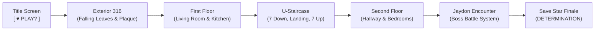

# ♥ Undertale: 4th Anniversary Tribute ♥
### *A playable top-down tribute game celebrating 4 years of Mallika & Jaydon*

---

> [!NOTE]
> **Dedication**: Built as a personalized surprise gift for Mallika & Jaydon's 4th Anniversary. The game faithfully captures the iconic mechanics, dialogue styling, sound design, and emotional warmth of Toby Fox's *Undertale*, while recreating the real-world architecture, memories, inside jokes, and lived-in charm of their townhouse.

---

## 📑 Master Documentation Index

Detailed specifications have been split into modular, focused documents:

1. 🎨 **[Master Scene & Character Redesign Specification (`scene.md`)](scene.md)**
   - *Extensive handoff document for LLM / senior graphic designers.*
   - Contains architectural dimensions, exterior facade rules (Townhouse 316), half-split first-floor layout, U-shaped staircase, narrow second-floor corridor, and character sprite art rules for Mallika & Jaydon.

2. 💬 **[Master Interaction & Dialogue Catalog (`interactions.md`)](interactions.md)**
   - *Complete interaction encyclopedia.*
   - Catalogs every overworld inspectable, choice prompt (`[ YES / NO ]`), C-Menu descriptions, battle actions (Check, Flirt, Smoke, Hug, Items), and the Determination finale.

3. 🧭 **[User Preferences & Design Philosophy (`preferences.md`)](preferences.md)**
   - *Design rules and learned preferences.*
   - Tracks authentic Undertale visual guidelines, spatial proportions, text-wrapping limits, and character design choices accumulated across development.

---

## 🎮 Quick Start & Play Guide

The game requires **zero external build tools, npm packages, or external assets**. It is built completely with vanilla HTML5, Canvas 2D, and the Web Audio API.

### Option 1: Live Web Play (GitHub Pages)
Once enabled on GitHub Pages, the game is playable directly on mobile and desktop at:
👉 **`https://lasts3cond.github.io/4thAnniversary/`**

### Option 2: Local Web Server
If running locally via Python:
```powershell
python -m http.server 8080
```
Then open your browser to: **`http://localhost:8080`**

### Option 3: Direct File Execution
Double-click `index.html` in your file explorer to launch directly in any modern web browser.

---

## 🕹️ Controls Reference

| Key(s) | Function | Context |
|---|---|---|
| **Arrow Keys** or **W, A, S, D** | Move Mallika / Navigate Menus | Overworld / Menus |
| **Z** or **Enter** / **Left Click** | Interact / Confirm / Advance Dialogue | Overworld / Battle |
| **X** or **Shift** | Cancel / Skip / Speed Up Dialogue | Overworld / Battle |
| **C** or **Ctrl** | Open Overworld Menu (`ITEM`, `STAT`, `CELL`) | Overworld |

> [!TIP]
> **Audio Start**: Modern browsers restrict Web Audio autoplay until the user's first gesture. The game features an Undertale **`[ ♥ PLAY? ]`** start screen that seamlessly initializes and starts audio on your first click or keypress.

---

## 🏠 Game Overview & Progression



1. **Title Screen**: Classic Undertale title with pulsing red soul cursor and browser audio unlock.
2. **Exterior (Townhouse 316)**: Fall leaves drifting across an autumn lawn, red brick framing, and the iconic "316" plaque.
3. **First Floor (The Open Loop)**: A full-width living room across the top (L-couch and TV stand front and center, punching bag, puzzle table) with the kitchen and its warm oven below on the right.
4. **The Staircase**: A compact switchback U-shaped staircase descending to an intermediate landing window before ascending to the top floor.
5. **Second Floor**: A narrow corridor with roommates' doors (Alex, Kevin) leading to Jaydon's bedroom.
6. **Boss Encounter (Jaydon)**: Full Undertale battle engine with Fight meter, rotating Flirt responses, smoke breaks, and a warm hug that unlocks Mercy.
7. **The Finale**: A pulsing golden Save Star, Toby Fox's *Determination* melody, and a heartfelt anniversary message.

---

## 🏗️ Technical Architecture

- **Canvas 2D Rendering**: Native $640 \times 480$ letterboxed CRT viewport with nearest-neighbor scaling (`imageSmoothingEnabled = false`).
- **Web Audio Synthesizer**: Pure Web Audio API synthesizers producing retro square waves, triangle basses, and noise channels for all BGM (*Snowy*, *Home*, *Heartache*, *Determination*) and SFX without external MP3/WAV files.
- **Typewriter Text Engine**: Dynamic word-wrapping with Undertale dialogue box borders and portrait support.
- **Data-Driven Rooms**: Each room is one file in `src/rooms/` listing its walls and objects; an object bundles its art, collision, and interaction in a single entry (see [Adding an Interactive Object](#-adding-an-interactive-object)).
- **Zero Dependencies**: 100% vanilla JavaScript, HTML, and CSS.

---

## 📁 Codebase Manifest

| File | Purpose |
|---|---|
| `index.html` | CRT container, canvas viewport, and script bootstrap (scripts load in dependency order). |
| `style.css` | Retro CRT scanlines, CRT screen curvature, and letterboxing styling. |
| `src/game.js` | Main game loop and state machine (title, overworld, cutscene, battle, finale), Mallika's movement, and room transitions. |
| `src/core/input.js` | Keyboard and pointer input. |
| `src/core/text.js` | Shared word-wrapping and pagination used by every text box. |
| `src/audio.js` | Web Audio API synthesizer for all 4 music tracks and 10+ sound effects. |
| `src/sprites.js` | Procedural pixel art (native 320×240 art pixels, shown at 2x) for Mallika, Jaydon, portraits, UI, and a tiny 3×5 pixel font. |
| `src/dialogue.js` | Undertale dialogue boxes, typewriter animations, and `[ YES / NO ]` prompts. |
| `src/world/art.js` | Shared palette and room drawing helpers (wall blocks, side doors, drifting leaves, stepped glows). |
| `src/world/props.js` | Furniture and fixture sprites (couch, kitchen pieces, banner...), one `PropArt.define` each. |
| `src/world/interactions.js` | What objects do on Z: text, `[ YES / NO ]` choices, doors, and scripted interactions. |
| `src/world/map_manager.js` | Room registry, cached backgrounds, depth-sorted drawing, and collision / interaction lookups. |
| `src/rooms/*.js` | One file per room: walls, objects (art + collision + interaction), static background, and animated details (leaves, lantern, LED, oven glow). |
| `src/ui/title_screen.js` | The `[ ♥ PLAY? ]` title screen. |
| `src/ui/overworld_menu.js` | The C-menu (`ITEM`, `STAT`, `CELL`). |
| `src/battle.js` | Complete battle engine (FIGHT, ACT, ITEM, MERCY, damage capping). |
| `src/finale.js` | Golden Save Star, particle systems, and Determination climax. |
| `scene.md` | Master handoff document for LLM / character and scene redesign. |
| `interactions.md`| Master encyclopedia of all dialogue and overworld/battle interactions. |
| `preferences.md` | Recorded design guidelines and accumulated user preferences. |

---

## 🧩 Adding an Interactive Object

1. **Draw the sprite** in `src/world/props.js` (art pixels; `S.makeProp` adds the black outline):
   ```js
   PropArt.define('plant', (S) => S.makeProp(12, 20, (ctx, R, P) => {
     R(3, 13, 6, 7, '#8b5a2b');                              // pot
     R(1, 2, 10, 11, '#4f9b3a'); R(3, 0, 6, 2, '#4f9b3a');   // leaves
   }));
   ```
2. **Place it** with one entry in the room's `objects` list (e.g. `src/rooms/first_floor.js`):
   ```js
   {
     name: 'Plant',
     at: { x: 160, y: 74, w: 24, h: 40 },      // inspection zone (screen px)
     solid: true,                              // blocks walking (same rect as `at`)
     prop: { sprite: 'plant', x: 79, y: 36 },  // art px; makeProp sprites sit at (x - 1, y - 1)
     text: ["* A leafy plant. Someone remembers to water it."]
   }
   ```

Swap `text` or `prop` for whatever the object needs:

| Want | Use |
|---|---|
| A `[ YES / NO ]` prompt | `choice: { prompt: "* Water it?", yes: ["* Glug glug."], no: ["* Maybe later."] }` |
| A doorway to another room | `door: { to: 'staircase', x: 255, y: 90, dir: 'down', sound: true }` |
| Anything scripted | `onInteract: (game) => Interact.ask("* Water it?", () => { /* ... */ }, ["* Maybe later."])` |
| Art painted into the floor or wall (Mallika can't walk behind it) | `art: { sprite: 'plant', x: 79, y: 36 }` instead of `prop` |

- **Coordinates**: zones, walls and spawn points are screen pixels (640 × 480); sprite positions are art pixels (320 × 240, half of screen pixels).
- **Order matters**: when Mallika can reach two zones at once, the object listed first wins. `art` paints in list order (`layer: 1` puts it on top).
- **Keep the docs in sync**: add new text to `interactions.md` and new layout details to `scene.md`.

---
*Happy 4th Anniversary, Mallika & Jaydon! ♥*